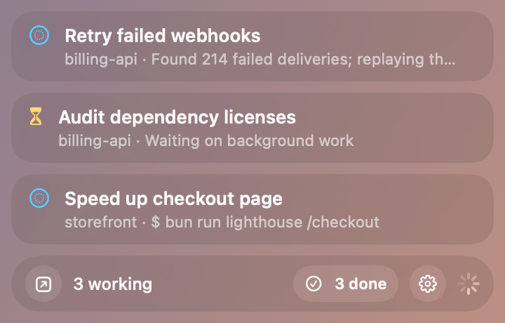
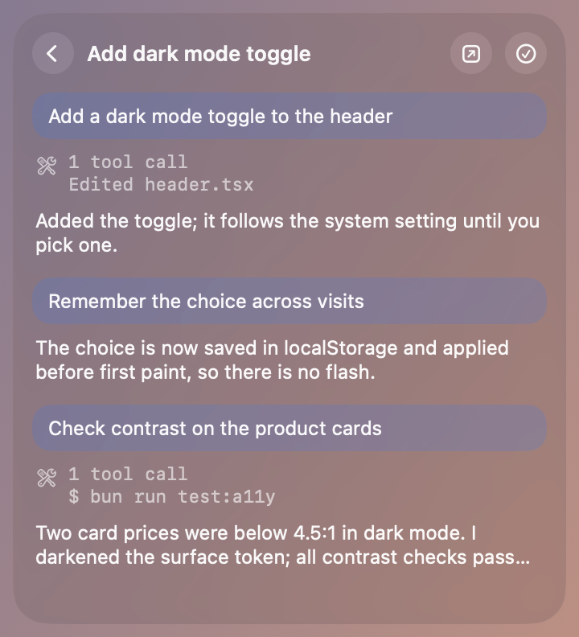

# tot

A floating macOS Liquid Glass overlay that shows which [T3 Code](https://t3.codes) threads are working and how many
have finished, so you can watch agents while something else is full screen. It only reads T3's data.

| Working threads and done count                                                    | A thread's last three turns                                                 |
| --------------------------------------------------------------------------------- | --------------------------------------------------------------------------- |
|  |  |

_Screenshots use mock data from [`docs/demo/demo-seed.sql`](docs/demo/demo-seed.sql)._

## Requirements

- macOS 26 or later, on Apple silicon or Intel.
- T3 Code, opened at least once, so `~/.t3/userdata/statev2.sqlite` exists.

## Install

```sh
mkdir -p ~/Applications
curl -fL -o /tmp/Tot.zip https://github.com/dakdevs/tot/releases/latest/download/Tot.zip
ditto -x -k /tmp/Tot.zip ~/Applications && rm /tmp/Tot.zip
open ~/Applications/Tot.app
```

Releases are currently ad-hoc signed, not notarized; each release's notes state its signing
([details](docs/releasing.md#signing)). macOS quarantines a copy
downloaded in a browser and won't open it; use the commands above or build from source.

From source (Xcode 26+, [XcodeGen](https://github.com/yonaskolb/XcodeGen), and [Bun](https://bun.sh)):

```sh
git clone https://github.com/dakdevs/tot.git && cd tot
bun install
bun run app
```

## Setup

The panel appears at the bottom right with no setup. Open Settings with its gear icon:

- **Thread summaries (optional).** Choose OpenCode (needs its background service running) or Codex (needs
  `codex login`), then a model. Tot uses the CLI's existing login.
- **Updates.** Tot checks hourly and asks before installing: choose **Install Update** or **Remind Me Later**.
  **Check for Updates…** works at any time.
- **Quit Tot** is at the bottom; Tot has no Dock icon or menu.

## Develop

```sh
bun test           # Swift unit tests and release-script tests
bun run test:e2e   # XCUITest: overlay and updater UI against fixtures
bun run lint && bun run prettier
```

More: [architecture and limitations](docs/architecture.md), [releases and updates](docs/releasing.md).
